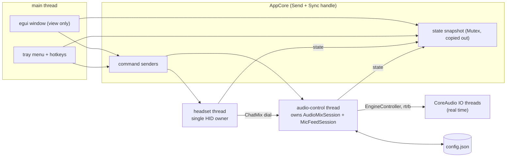

# The app (M5): `StealSeries.app`

Decision: [ADR 0005](../adr/0005-single-app-pure-rust-ui.md) — one menu-bar app, egui window,
services in-process. Scope: the ✅ v1 rows of [ADR 0001](../adr/0001-v1-scope.md) that are not
DSP/driver work, plus the owner's AudioMix master switch ([overview.md §7](overview.md)).

## 1. Threads and ownership



- **Headset thread** — the only owner of the HID device (engine.md §10 lesson). Polls events,
  executes commands, reconnects on hot-plug, forwards dial events to the audio thread.
- **Audio-control thread** — CoreAudio sessions hold non-`Send` blocks, so one thread creates,
  updates and drops them. Live parameter changes go through `EngineController` (no rebuild);
  routing changes rebuild the taps. Every 2 s it re-scans audio processes and devices: an
  assigned app that starts later, or a reconnected headset, triggers a rebuild.
- **UI / tray / hotkeys** never touch devices: they send commands and render the latest snapshot.
  Tray and hotkey handlers act on `AppCore` directly, so they work while the window is hidden.

## 2. Features (v1)

| Area | In the app |
|---|---|
| AudioMix | **master switch** (off = no taps, no aggregate devices); output device; per-app channel assignment (by bundle id, persisted); per channel fader, mute, PEQ, boosts, Smart Volume; ChatMix from the dial; conflict warning for known tap tools |
| Mic | on/off; source mic; mic chain (denoise, gate, stabilizer, EQ, gain); status of the virtual-mic driver |
| Headset | connection, battery, ANC/transparency, sidetone, mic volume, hardware EQ preset, auto-off, OLED brightness (all existing `ss-nova-pro` commands) |
| App | menu-bar icon with quick toggles, window, autostart (LaunchAgent), global hotkeys (ChatMix, mute), settings saved automatically |

## 3. Configuration (`ss-store`)

`~/Library/Application Support/StealSeries/config.json`, versioned (`"version": 1`), written
atomically (temp file + rename) and debounced (500 ms). Domain types stay serde-free; `ss-store`
owns the DTOs and the mapping. Unknown/invalid files are moved aside to `config.invalid-<ts>.json`
and defaults are used (never crash on a bad file).

```jsonc
{
  "version": 1,
  "audiomix": {
    "enabled": false,                    // master switch, default OFF
    "output_device_uid": null,            // null = system default
    "assignments": { "com.spotify.client": "media", "com.hnc.Discord": "chat" },
    "channels": { "game": { "volume": 1.0, "muted": false, "strip": { /* eq, boosts, smart volume */ } } }
  },
  "mic": { "enabled": false, "input_device_uid": null, "chain": { /* MicChainSettings */ } },
  "app": { "autostart": false, "hotkeys": { "chatmix_game": "Ctrl+Alt+Left", "chatmix_chat": "Ctrl+Alt+Right", "mic_mute": "Ctrl+Alt+M" } }
}
```

## 4. Crates

| Crate | Responsibility |
|---|---|
| `ss-store` | config DTOs, load/save, migration, defaults (portable, unit-tested) |
| `ss-app` (bin) | composition root: `AppCore`, headset + audio threads, egui UI, tray, hotkeys, autostart; macOS bundle via `scripts/macos/app.sh` |

`AppCore`'s state machine (what to (re)build for which config/process/device change) is plain Rust
and unit-tested without CoreAudio; the CoreAudio calls sit behind a small trait so tests use a fake.

## 5. Bundle

`StealSeries.app/Contents/{Info.plist, MacOS/stealseries, Resources/}`; `LSUIElement = true`,
`NSAudioCaptureUsageDescription`, `NSMicrophoneUsageDescription`, `LSMinimumSystemVersion 14.4`,
ad-hoc signed for development (Developer ID + notarisation later). Optional: install the
virtual-mic driver from the app (asks for the admin password via the system dialog).
