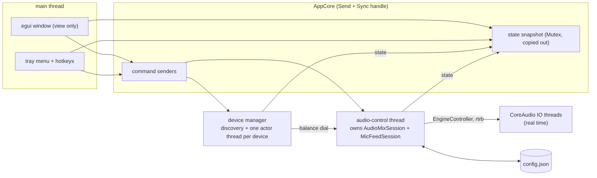

# The app (M5): `OpenSeries.app`

Decision: [ADR 0005](../adr/0005-single-app-pure-rust-ui.md) — one menu-bar app, egui window,
services in-process. Scope: the ✅ v1 rows of [ADR 0001](../adr/0001-v1-scope.md) that are not
DSP/driver work, plus the owner's AudioMix master switch ([overview.md §7](overview.md)).

## 1. Threads and ownership



- **Device manager** (`src/devices.rs`, ADR 0008, [devices.md](devices.md)) — scans every
  transport every 2 s, opens only candidates an enabled driver recognises and gives each device
  its own **actor thread**, the only owner of that device (engine.md §10 lesson). Actors poll
  events, execute feature writes, re-read after host changes, take over the Game/Chat dial while
  AudioMix runs (`Role::HostMixer`) and forward dial moves to the audio thread. Hot-plug and
  several devices at once are supported; the snapshot holds a device-neutral `DevicesState`.
- **Audio-control thread** — CoreAudio sessions hold non-`Send` blocks, so one thread creates,
  updates and drops them. Live parameter changes go through `EngineController` (no rebuild);
  routing changes rebuild the taps. Every 2 s it re-scans audio processes and devices: an
  assigned app that starts later, or a reconnected headset, triggers a rebuild.
- **UI / tray / hotkeys** never touch devices: they send commands and render the latest snapshot.
  Tray and hotkey handlers act on `AppCore` directly, so they work while the window is hidden.

## 2. Features (v1)

| Area | In the app |
|---|---|
| AudioMix | **master switch** (off = no taps, no aggregate devices); output device; per-app channel assignment (by bundle id, persisted); per channel fader, mute, PEQ, boosts, Smart Volume; ChatMix from the dial; conflict warning for known tap tools |
| Mic | on/off; source mic; mic chain (denoise, gate, stabilizer, EQ, gain); status of the virtual-mic driver |
| Headset | device info (firmware versions via `06 10` in GG notation, USB PID and `bcdDevice`), connection, battery, ANC/transparency, sidetone, mic volume, hardware EQ preset and custom 10-band curve editor (HS-01; shown when "Custom" is selected, writes `06 33` on release, bands numbered because their centre frequencies are Unknown; kept in the base station's RAM — saving to flash `06 09` is untested), auto-off, OLED brightness (all existing `ss-nova-pro` commands) |
| App | menu-bar icon with quick toggles, window, autostart (LaunchAgent), global hotkeys (ChatMix, mute), settings saved automatically |

Notes on v1 behaviour:
- **Mic mute hotkey** toggles the mic feed (OpenSeries Microphone goes silent); a click-free live
  mute needs the mic command queue (later).
- **Reconnect USB** is on the headset page, in the menu-bar menu and on a hotkey (default Ctrl+Alt+R): the manual cure for both kinds of crackling (`docs/hardware/macos-app.md` Findings).
- **ChatMix hotkeys** move a software balance in steps of 10 %; moving the headset dial overrides it.
- **Reset OpenSeries settings…** (DEV-12, app part; Settings, with a confirmation step):
  `Config::reset_keeping_presets` — every setting back to its default (AudioMix and virtual mic
  off, autostart off and its registration removed, hotkeys default, onboarding shown again),
  saved presets kept. The headset's own factory reset (`06 FD`) is **not** offered: the command
  is unverified and possibly irreversible (`nova-pro-wireless.md`), so it waits for an owner
  decision and a supervised test.
- **Getting started** (onboarding): a window on first start (until "Done", `app.onboarding_done`;
  Settings → "Show getting started" reopens it) with a live checklist — base station connected,
  headset on, AudioMix running, on macOS the mic driver installed and the virtual mic running,
  start at login — each with its action button and a short hint (`ui::onboarding::steps`, unit
  tested). **Install driver…** (macOS) copies `OpenSeriesMic.driver` from
  `OpenSeries.app/Contents/Resources` (put there by `scripts/macos/app.sh`) to
  `/Library/Audio/Plug-Ins/HAL` and restarts `coreaudiod` through `osascript … with administrator
  privileges` — the same steps as `hal-driver.sh install`, **untested on the Mac** so far.
- **Live mic chain changes**: changing denoise, gate, stabilizer, mic EQ or gain no longer
  restarts the mic feed (no audible gap); only a different source device does. See
  [mic-chain.md §5](mic-chain.md).
- **Virtual mic as default input** (SON-06, macOS; Microphone page option, off by default): when
  the mic feed starts, the supervisor makes "OpenSeries Microphone" the system default input
  (`kAudioHardwarePropertyDefaultInputDevice`, `ss_audio_macos::set_default_input_device`) and
  remembers the previous default; when the feed stops (switch off, failure, quit) it restores that
  default — but only if ours is still the default, so a choice made by hand meanwhile is kept. It
  acts only on these transitions, never on every rescan. Not offered on Windows until M4b.
- **Backup devices** (SON-27/28): AudioMix output and mic source each have an ordered backup
  list ("Backup outputs" / "Backup microphones"). `plan::resolve_device` picks the selected device
  (or the system default) while it is connected, else the first connected backup; the plan then
  differs and the supervisor rebuilds the session, and it switches back when the selection
  returns. Option "Switch to the backups while the headset is turned off": the headset's devices
  (name contains "Arctis Nova Pro Wireless") count as missing while the base station reports the
  headset unlinked — a polling thread forwards the link state to the audio thread
  (`AudioMsg::HeadsetLinked`). Without backups the selection behaves exactly as before. On Windows
  (M4a session mixer) no audio passes through the app, so this has no effect until M4b.
- **Desktop notifications** (CORE-15, NTU-02; Settings → "Desktop notifications", on by default,
  "Test" button): headset linked/unlinked, base station gone/back (e.g. its input switched to the
  other computer, see `nova-pro-wireless.md`), headset battery ≤ 25 % while discharging (once,
  re-armed when charging or ≥ 50 %), AudioMix / virtual mic failing. `alerts::AlertTracker` derives
  them from snapshot changes (no alerts at start-up); a background thread polls once per second,
  so they also appear while the window is hidden. `notify-rust` shows them (Windows toast via the
  PowerShell app id, as no AUMID is registered — the toast may name PowerShell as its source).
- **Hotkey editor** (Settings → Hotkeys): "Change" records the next key combination (needs Ctrl,
  Alt or Cmd; Esc cancels; a combination used by another action is refused), "Clear" unbinds,
  "Reset to defaults". All global hotkeys are unregistered while recording so the OS does not
  swallow the combination, and re-registered live when the config changes (no restart).
- Changing mic processing restarts the mic feed briefly (no live control of the chain yet).

## 3. Configuration (`ss-store`)

`~/Library/Application Support/OpenSeries/config.json`, versioned (`"version": 1`), written
atomically (temp file + rename) and debounced (500 ms). Domain types stay serde-free; `ss-store`
owns the DTOs and the mapping. Unknown/invalid files are moved aside to `config.invalid-<ts>.json`
and defaults are used (never crash on a bad file).

```jsonc
{
  "version": 1,
  "audiomix": {
    "enabled": false,                    // master switch, default OFF
    "output_device_uid": null,            // null = system default
    "assignments": { "com.spotify.client": "media", "com.hnc.Discord": "chat" },
    "channels": { "game": { "volume": 1.0, "muted": false, "strip": { /* eq, boosts, smart volume */ } } }
  },
  "mic": { "enabled": false, "input_device_uid": null, "chain": { /* MicChainSettings */ } },
  "app": { "autostart": false, "hotkeys": { "chatmix_game": "Ctrl+Alt+Left", "chatmix_chat": "Ctrl+Alt+Right", "mic_mute": "Ctrl+Alt+M" } },
  "presets": { "headset_eq": { "Footsteps": [0, 0, -2, 0, 3, 5, 4, 2, 0, 0] }, "playback": { /* name → channel */ }, "mic": { /* name → mic */ } }
}
```

### 3.1 Presets (SON-15, SON-17, HS-01)

`ss_store::presets`: named presets of three kinds, kept in `config.json` (map name → settings, so
names are unique per kind and sorted):

| Kind | Content | Applied by | Where in the UI |
|---|---|---|---|
| Headset EQ | 10 band gains (dB) | `06 33` + re-select Custom | Headset page, under the custom EQ (shown when "Custom" is active) |
| Playback | one channel's EQ, boosts, Smart Volume, volume boost — **not** the fader | replaces the channel strip, fader kept | AudioMix page, per channel (macOS; hidden on Windows until M4b) |
| Microphone | mic chain (denoise, gate, stabilizer, EQ, gain) — **not** the switch or source device | replaces the chain, switch and source kept | Microphone page |

The shared preset bar: pick a preset to apply it, "Save current" under a name (same name replaces),
Delete, Export… / Import… through the system file dialog (`rfd`). Export writes one preset as
`{"format": "openseries-preset", "version": 1, "name", "kind", "settings"}`. Import reads that and,
best effort, a **Sonar config object** (`docs/re/sonar.md` §4.2): `virtualAudioDevice`
`game|chatRender|media|aux` → playback, `chatCapture` → microphone; PEQ filters, boosts, Smart
Volume, general gain, noise cancelling / gate / stabilizer are mapped. Whether GG's own export file
is exactly that object is **Inferred**; virtual surround and AEC have no counterpart yet and are
dropped. An imported preset of another kind lands in that kind's list.

## 4. Crates

| Crate | Responsibility |
|---|---|
| `ss-store` | config DTOs, load/save, migration, defaults (portable, unit-tested) |
| `ss-app` (bin) | composition root: `AppCore`, headset + audio threads, egui UI, tray, hotkeys, autostart, update thread; macOS bundle via `scripts/macos/app.sh` |
| `ss-update` | release lookup (GitHub JSON, semver, package choice) and Ed25519 signature check for in-app updates; `ss-release-sign` tool for CI ([release.md](release.md)) |

`AppCore`'s state machine (what to (re)build for which config/process/device change) is plain Rust
and unit-tested without CoreAudio; the CoreAudio calls sit behind a small trait so tests use a fake.

## 5. Bundle

`OpenSeries.app/Contents/{Info.plist, MacOS/openseries, Resources/}`; `LSUIElement = true`,
`NSAudioCaptureUsageDescription`, `NSMicrophoneUsageDescription`, `LSMinimumSystemVersion 14.4`,
ad-hoc signed for development; release builds are Developer ID signed (hardened runtime) and
notarized in CI ([release.md](release.md) §3, ADR 0006). Built and installed to
`~/Applications` by `scripts/macos/app.sh build|install`. Ad-hoc signatures change with each build,
so macOS may ask for permissions again after an update (**Inferred**). Later: install the
virtual-mic driver from the app (admin password via the system dialog).

## 6. Platforms

The app crate is shared by macOS and Windows (ADR 0005). Everything OS-specific lives in
`crates/ss-app/src/platform/` behind the same names per OS; the rest of the app has no
`cfg(target_os)`.

| Piece | macOS | Windows |
|---|---|---|
| UI, tray, hotkeys (egui, `tray-icon`, `global-hotkey`) | ✅ | ✅ (same crates) |
| Headset control (`ss-nova-pro` over hidapi) | ✅ | ✅ (verified with `ssctl` in M1) |
| Config (`ss-store`), supervisor logic, DSP, mic chain | ✅ | ✅ (portable) |
| AudioMix + virtual mic | process taps + HAL driver | session mixer (`ss-audio-windows`: per-app volumes, ChatMix); **no** channel DSP and **no** virtual mic on Windows (ADR 0004: would need paid driver signing) |
| Autostart | LaunchAgent | `HKCU\…\Run` via `reg.exe` (verified 2026-11-14) |
| Reconnect USB | IOUSBHost re-enumeration | not yet (button hidden) |
| Fix crackling automatically | `usbaudiod` underflow log stream | not yet (option disabled) |
| Notification sender | `set_application(dev.openseries.app)` | AUMID `OpenSeries.App` registered under `HKCU\Software\Classes\AppUserModelId` (name + icon) and on the Start-menu shortcut; without it toasts show "PowerShell" (Observed 2026-11-15) |
| App icon | `AppIcon.icns` built by `app.sh` (`sips`, `iconutil`) | embedded in `openseries.exe` by `build.rs` (`winresource`), installer icon |
| Install an update (ADR 0006) | swap the `.app` bundle after quitting | silent Inno Setup installer |
| Show the hidden window from the tray | `ViewportCommand::Visible` | Win32 `ShowWindow` via `ss-window-windows` (see below) |

**Hidden window on Windows (Observed 2026-11-14):** eframe only runs UI frames on `WM_PAINT`, which
Windows never sends to a hidden window. After closing the window to the tray, the queued
`Visible(true)` command was therefore never applied and "Open OpenSeries…" did nothing. The tray
handler now shows the window natively (`platform::NativeWindow`, HWND taken from the creation
context) before sending the viewport command.

**Known gap:** the Windows build of `ss-app` is not compiled on the owner's Mac (no Windows target
installed); it has to be checked on Windows or in CI.

## 7. Fix crackling automatically

Off by default (`app.auto_fix_crackling`). macOS: `/usr/bin/log stream` filtered to `usbaudiod`
"USB underflow" messages (no admin rights). `crackle::BurstDetector` triggers a USB reset when
≥ 20 underflows arrive within 3 s, at most once per 30 s (observed crackling episodes produce
20–50 per second; normal operation none). The Settings page shows how often it fixed crackling.

## 8. Device gate (owner requirement 2026-11-15)

Since ADR 0008 the gate is "a **supported and enabled device** is connected" (it was "a Nova Pro
base station is connected"); the behaviour below is unchanged for the Nova Pro.

OpenSeries only acts while an **Arctis Nova Pro Wireless base station is connected**. Without it
the app is completely passive, so it never interferes with other headsets on the same computer
(e.g. a guest's HyperX on the owner's Mac):

| Part | Base station connected | No base station |
|---|---|---|
| AudioMix (taps / session volumes) | runs as configured | stopped; Windows session volumes restored |
| Virtual-mic feed | runs as configured | stopped |
| System default input (SON-06) | switched while the feed runs | restored / left alone |
| Global hotkeys | registered | **unregistered** (keys free for other apps) |
| Automatic crackling fix (USB resets) | as configured | off |
| Headset thread | talks to the base station | only enumerates HID devices with the Nova Pro VID/PID — never opens others |
| Window, tray, notifications | normal | window shows "paused" banner; tray says paused |

The config is not changed, so everything resumes on its own when the base station returns.
"Connected" is the headset thread's `base_station` flag; until the first scan it counts as not
connected (fail safe: nothing starts before the base station is seen). Development runs with
`OPENSERIES_NO_HEADSET=1` have no headset thread and skip the gate.

## 9. Single instance (owner requirement 2026-11-15)

Only one OpenSeries runs per user. A new start **replaces** the running one instead of being
refused, so starting the app again (Start menu, a development build next to the installed one,
the installer after an update) always ends with the newest binary running (`src/instance.rs`):

1. The running app listens on a random `127.0.0.1` port and writes `{pid, port, token}` to
   `instance.json` next to `config.json` (removed again on quit).
2. A new start reads the record, connects, checks the greeting `openseries <token>` (a stale
   port reused by another program never matches), sends `quit <token>` and waits until the
   connection closes, i.e. the old process has run its normal quit (restore app volumes and the
   default input, save the config) and exited. Only then does it open the base station — on
   macOS hidapi opens it exclusively.
3. A verified old instance that does not exit within 10 s is terminated (`taskkill /F` /
   `kill -9`); a missing or stale record means nothing runs.

Development runs with another `APPDATA` / `HOME` (screenshots) have their own config directory and
therefore their own instance. Builds from before this change do not listen; they have to be quit
by hand once.
