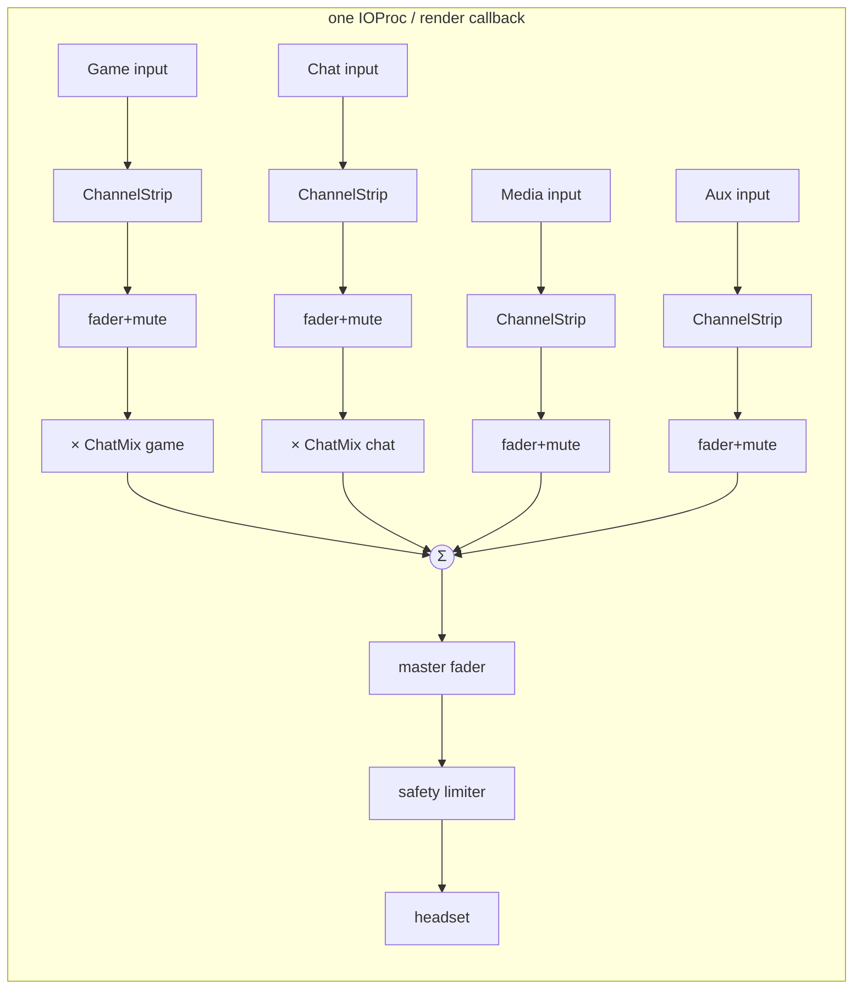
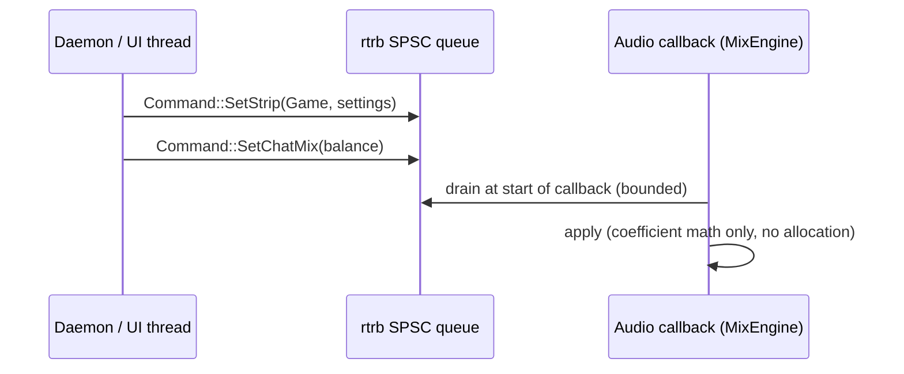

# Audio engine (`ss-engine`) and platform backends

Implements the mixing core of AudioMix. Decision context: [ADR 0002](../adr/0002-macos-audio-strategy.md).

## 1. Signal flow per audio callback

- Each channel: `ChannelStrip` (EQ → boosts → Smart Volume → gain) from `ss-dsp`, then a smoothed
  fader/mute gain. Game and Chat additionally get the ChatMix gain pair.
- A final soft-clip limiter prevents digital clipping after summing.
- Channel inputs may have different channel counts (e.g. mono chat); they are up/down-mixed to the
  output layout before summing (v1: mono → all channels, stereo → L/R, extra channels dropped).

## 2. Control path (real-time safe)

- `MixEngine` owns all processors; it is constructed on the control thread and then **moved** into
  the callback. Control talks to it only through `EngineController` (producer side of the queue).
- Commands are small `Copy` values; the queue has fixed capacity; if it is full the controller
  reports `Busy` instead of blocking.
- Metering (peak per channel) flows back through a second queue (later).

## 3. Crates

| Crate | OS | Responsibility |
|---|---|---|
| `ss-engine` | any | `MixEngine`, `EngineController`, commands, channel model; fully unit-tested on Windows |
| `ss-audio-macos` | macOS | Process list, process taps, private aggregate device, IOProc → `MixEngine` |
| `ss-hal-driver-macos` | macOS | M3b: loopback AudioServerPlugIn for the virtual microphone ([design](virtual-mic-driver.md)) |
| `ss-audio-windows` | Windows | M4a: session mixer (per-app session volumes, ChatMix); M4b: virtual-driver capture → `MixEngine` → headset ([ADR 0004](../adr/0004-windows-audio-strategy.md); process loopback alone cannot silence the original) |

## 4. macOS backend outline (M3a)

1. Resolve the headset output device (`kAudioHardwarePropertyDevices`, match name/UID).
2. For each channel with assigned apps: translate PIDs → audio process objects
   (`kAudioHardwarePropertyTranslatePIDToProcessObject`), create a `CATapDescription`
   (stereo mixdown of those processes, `muteBehavior = mutedWhenTapped`), `AudioHardwareCreateProcessTap`.
3. Media channel: a global tap that **excludes** all processes assigned elsewhere.
4. Create a private aggregate device (`AudioHardwareCreateAggregateDevice`) with the headset as main
   sub-device and all taps in `kAudioAggregateDeviceTapListKey`, drift compensation on.
5. `AudioDeviceCreateIOProcIDWithBlock` → map input buffer list (one stream per tap) to engine channels,
   run `MixEngine::process`, write the output buffer.
6. Re-create taps/aggregate when assignments or devices change (outside the callback).
