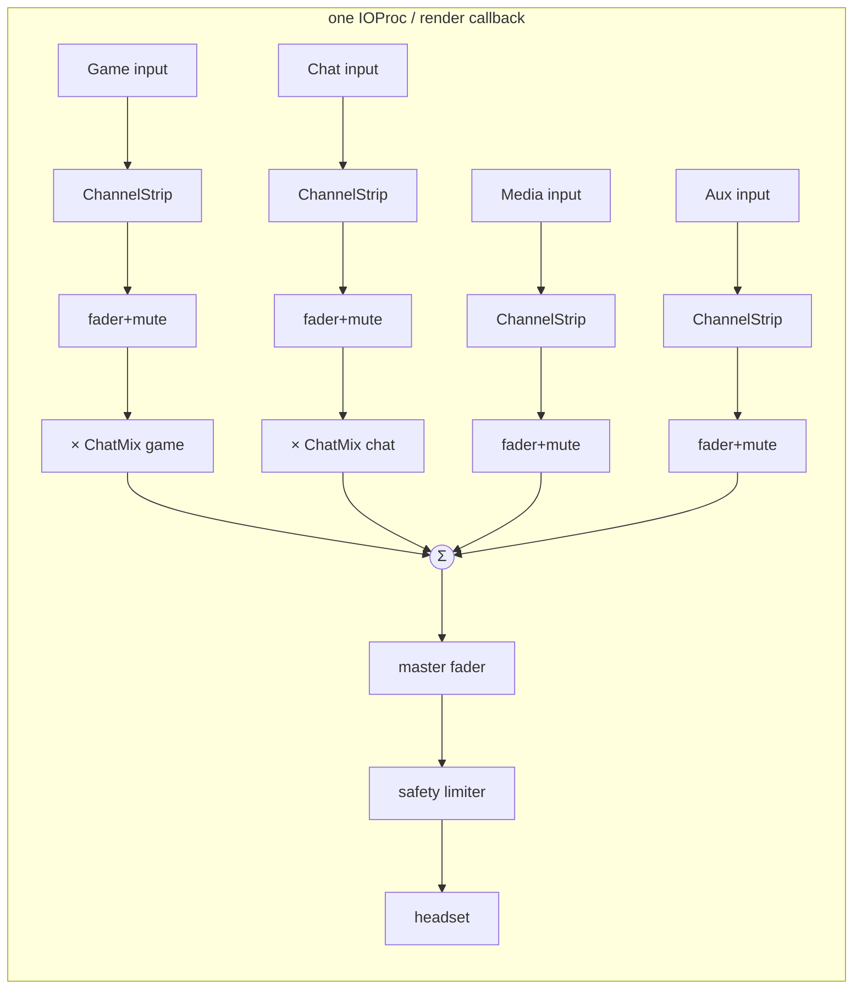
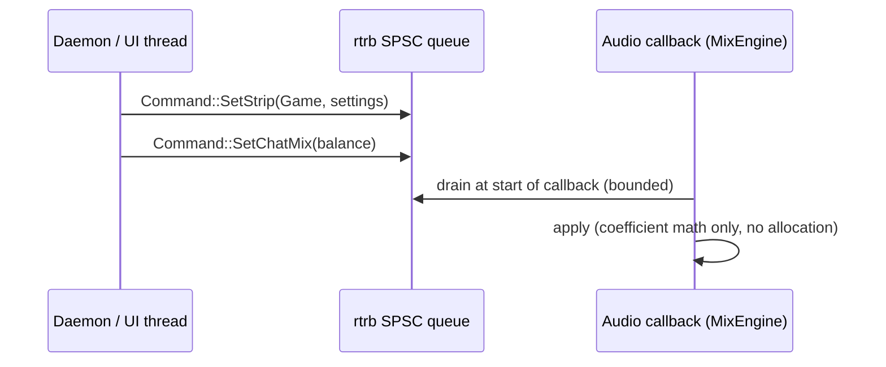

# Audio engine (`ss-engine`) and platform backends

Implements the mixing core of AudioMix. Decision context: [ADR 0002](../adr/0002-macos-audio-strategy.md).

## 1. Signal flow per audio callback



- Each channel: `ChannelStrip` (EQ → boosts → Smart Volume → gain) from `ss-dsp`, then a smoothed
  fader/mute gain. Game and Chat additionally get the ChatMix gain pair.
- A final soft-clip limiter prevents digital clipping after summing.
- Channel inputs may have different channel counts (e.g. mono chat); they are up/down-mixed to the
  output layout before summing (v1: mono → all channels, stereo → L/R, extra channels dropped).

## 2. Control path (real-time safe)



- `MixEngine` owns all processors; it is constructed on the control thread and then **moved** into
  the callback. Control talks to it only through `EngineController` (producer side of the queue).
- Commands are small `Copy` values; the queue has fixed capacity; if it is full the controller
  reports `Busy` instead of blocking.
- Metering (peak per channel) flows back through a second queue (later).

## 3. Crates

| Crate | OS | Responsibility |
|---|---|---|
| `ss-engine` | any | `MixEngine`, `EngineController`, commands, channel model, `DriftBuffer` (clock-drift compensation between two devices, for M4b); fully unit-tested on Windows |
| `ss-audio-macos` | macOS | Process list, process taps, private aggregate device, IOProc → `MixEngine` |
| `ss-hal-driver-macos` | macOS | M3b: loopback AudioServerPlugIn for the virtual microphone ([design](virtual-mic-driver.md)) |
| `ss-audio-windows` | Windows | M4a: session mixer (per-app session volumes, ChatMix); M4b: virtual-driver capture → `MixEngine` → headset ([ADR 0004](../adr/0004-windows-audio-strategy.md); process loopback alone cannot silence the original) |

## 4. macOS backend outline (M3a)

1. Resolve the headset output device (`kAudioHardwarePropertyDevices`, match name/UID).
2. For each channel with assigned apps: translate PIDs → audio process objects
   (`kAudioHardwarePropertyTranslatePIDToProcessObject`), create a `CATapDescription`
   (stereo mixdown of those processes, `muteBehavior = mutedWhenTapped`), `AudioHardwareCreateProcessTap`.
3. Media channel: a global tap that **excludes** all processes assigned elsewhere.
4. Create a private aggregate device (`AudioHardwareCreateAggregateDevice`) with the headset as main
   sub-device and all taps in `kAudioAggregateDeviceTapListKey`, drift compensation on.
5. `AudioDeviceCreateIOProcIDWithBlock` → map input buffer list (one stream per tap) to engine channels,
   run `MixEngine::process`, write the output buffer.
6. Re-create taps/aggregate when assignments or devices change (outside the callback).

## 5. Windows backend, M4a: session mixer ([ADR 0004](../adr/0004-windows-audio-strategy.md))

No audio passes through our process on Windows yet. Instead, `ss-audio-windows` sets each app's
**session volume** (`ISimpleAudioVolume`, the per-app slider in the Windows volume mixer) to

```text
session volume = original volume × channel fader × ChatMix gain (Game/Chat only) × master
```

with the same fader and ChatMix law (`ss_dsp::chatmix_gains`) as `MixEngine`. Per-channel EQ,
boosts, Smart Volume and volume boost above 0 dB need the M4b driver; the UI says so on Windows.

1. **Apps:** the audio sessions of all active render endpoints. The app identity used for
   channel assignments is the lower-case executable name (`chrome.exe`, `discord.exe`), stored in
   the same `assignments` map that holds bundle ids on macOS. Sessions of pid 0 (system sounds) are
   left alone.
2. **Start:** the `MixHandle` remembers every session's original volume, then writes the target.
   New sessions found on the 2 s rescan (`MixHandle::refresh`) are adopted the same way.
3. **User changes while running:** if a session's volume differs from what we last wrote, the user
   moved it in the Windows mixer; we take `current / gain` as the new original instead of fighting
   it.
4. **Stop:** dropping the handle writes every original back.
5. **Crash safety:** Windows persists per-app session volumes across restarts, so a crash would
   leave apps quieter. Originals are written to `%APPDATA%\StealSeries\session-volumes.txt`
   (keyed by the session identifier, which is stable per app) before we change anything and removed
   once restored. While no mix runs, the backend restores any listed session it finds, including
   apps that were closed while the mix was running.

Session volume is a linear amplitude factor (**Observed** 2026-11-14 with `winspike --silence half`:
volume 0.5 → loopback 6.0–6.3 dB lower, [windows-audiomix.md](../hardware/windows-audiomix.md) check 2),
so the gains match `MixEngine`.
