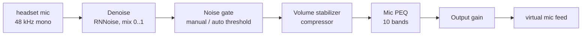

# Mic chain (M6): denoise → gate → compressor → mic EQ

Processes the headset microphone before it reaches the virtual "OpenSeries Microphone"
([virtual-mic-driver.md §7](virtual-mic-driver.md)). Covers SON-19 (AI noise cancelling),
SON-21 (noise gate, manual + automatic threshold), SON-23 (volume stabilizer) and SON-25 (mic EQ)
from [feature-inventory.md](../re/feature-inventory.md). Later: SON-22 (impact NR), SON-24 (AEC).

## 1. What we know about the original ([sonar.md §3.2](../re/sonar.md))

| Original (`CMic` graph, capture config JSON) | Status | Our decision |
|---|---|---|
| DNN denoise "ClearCast AI" (`R-Vox_DnzDrvMultiChannel_4.0.0.onnx`, DeepVQE-S style), `noiseCancelingState{value = mix 0..1}`, default 0.9 | Observed | Open model instead of the proprietary one: **RNNoise** via `nnnoiseless` first, DeepFilterNet later. Same parameter: dry/wet **mix 0..1, default 0.9**. |
| `noiseGateState{value = threshold dB}` default −60, `automaticNoiseGateState`, `kSet_NoiseGate{…,AutoThreshold,OffsetDB}` | Observed (names, default) | Existing `ss-dsp::NoiseGate`; automatic mode = noise-floor tracker + offset (§4). Offset default is ours (+10 dB, original Unknown). |
| `volumeStabilizerState` → `kSet_CaptureCompressor{State,Level}` | Observed (names) | Existing `ss-dsp::Compressor` with a voice preset; curve is ours (original Unknown). |
| `parametricEQ` on capture (10 bands, same filter types) | Observed | Existing `ss-dsp::ParametricEq`, same settings model as playback. |
| Block order inside `CMic` | Unknown | Ours, see §2. |

## 2. Signal flow



Order rationale:

1. **Denoise first**: the model is trained on raw noisy speech; every block before it would change
   the noise it has to recognise.
2. **Gate after denoise**: the residual floor is much lower, so the gate threshold separates voice
   from silence reliably and does not chatter on fan noise.
3. **Compressor after the gate**: its makeup gain must not lift the floor in pauses.
4. **EQ last**: tonal shaping of the final voice; boosts are not undone by the compressor.

Every block can be bypassed. Only the denoiser adds latency; with denoise off the chain has none.

## 3. Denoise block (`ss-dsp::Denoiser`)

- `nnnoiseless` 0.5.2, **BSD-3-Clause** (compatible with MIT OR Apache-2.0; notice in
  `THIRD_PARTY` when we ship binaries), `default-features = false` (drops its CLI deps). The model
  weights are compiled into the crate — nothing to download.
- RNNoise works on **480-sample frames at 48 kHz** with samples scaled to the `i16` range
  (±32768). The block converts scale on the way in and out.
- **Frame adaptation**: the IOProc delivers 512-frame blocks. A fixed input FIFO collects samples,
  each full 480-frame is denoised into an output FIFO, and output starts after priming with one
  frame of silence. Result: a **constant latency of 960 samples (20 ms)** = 480 (FIFO) + 480
  (RNNoise overlap-add), independent of the callback size (**Observed** in the unit tests
  `latency_matches_an_impulse` and `wet_path_is_aligned_with_the_dry_path`). Both FIFOs are allocated in
  `new()` for the largest supported callback (4096 frames).
- **Mix**: `out = mix · denoised + (1 − mix) · dry`, where `dry` is delayed by the same total
  latency so both are time-aligned (the alignment is measured in a unit test with an impulse).
- Real-time safety: `DenoiseState` allocates only in `new()`; `process_frame` uses stack arrays
  and pre-planned FFT buffers. **Observed**: `crates/ss-dsp/tests/no_allocation.rs` counts zero
  allocations over 200 blocks of the full chain (with a control test proving the counter works).
  RNNoise has no reset; `reset()` only clears the FIFOs instead of re-creating it (would allocate).
- Total added mic latency target: **≤ 25 ms** (measured end to end in the hardware test).

## 4. Automatic gate threshold

`threshold = noise_floor + offset`, where `noise_floor` is the minimum of the block **peak** (dBFS) over
a sliding window of ~2 s with slow upward drift (minimum statistics), evaluated **after** the
denoiser. Clamped to −80…−20 dBFS. Manual mode uses the configured threshold as today.
Peak, not RMS: the gate detector works on peaks, and noise peaks sit ~10 dB above its RMS; an
RMS floor left the gate chattering on steady noise (**Observed** with `ssdsp --mic` on synthetic
noise, now covered by `automatic_gate_closes_on_steady_noise`).

Blocks below −100 dBFS are ignored by the tracker: digital silence (the denoiser's priming
frames, a muted source) is not room noise. Without this the floor stuck at −120 dB, the gate stayed
open and the stabilizer amplified the noise (**Observed** with `ssdsp --mic`; regression test
`full_chain_does_not_lift_steady_noise`).

### Offline measurements (`ssdsp --mic`, synthetic 48 kHz files, 2026-11-14)

Gaussian-like room noise at −55 dBFS RMS, a 220 Hz "voice" tone at −13.5 dBFS from 1 s to 2 s:

| Chain | Noise, first second | Tone | Noise after the tone |
|---|---|---|---|
| input | −54.9 | −13.5 | −55.0 |
| `--denoise` (mix 0.9) | −56.0 | −13.5 | −73.9 |
| `--auto-gate` | −134.9 | −13.5 | −77.8 |
| `--denoise --auto-gate --stabilizer` | −127.0 | −16.8 | −88.7 |

Findings: RNNoise needs about **1 s** to learn stationary noise (first second only −1…−3 dB).
At mix 0.9 the denoiser alone cannot go below −20 dB (10 % dry). The gate's release is a time
constant: closing to −80 dB takes about 1 s (~3.5 dB per 50 ms) — tune in the listening test.
Very loud noise (> −30 dBFS peaks) keeps the gate open because the automatic threshold is capped
at −20 dBFS so speech is never cut.

## 5. API (platform-free, `ss-dsp`)

```rust
pub struct MicChainSettings {
    pub denoise: Option<f32>,              // mix 0..=1, None = off
    pub gate: Option<GateMode>,            // Manual(threshold dB) | Automatic { offset_db }
    pub stabilizer: Option<CompressorSettings>,
    pub eq: ParametricEqSettings,
    pub gain_db: f32,
}
pub struct MicChain { /* Denoiser, NoiseGate, Compressor, ParametricEq, Gain */ }
impl MicChain {
    pub fn new(sample_rate: f32, max_block: usize) -> Result<Self, DspError>; // mono
    pub fn set(&mut self, settings: &MicChainSettings);   // no allocation
    pub fn warm_up(&mut self);                             // once per audio thread, see below
    pub fn latency_frames(&self) -> usize;
}
impl Processor for MicChain { /* in place, mono */ }
```

- `MicFeedSession` (macOS) takes a `MicChain` and runs it in the IOProc between the mono mixdown
  and the feed buffer. **Live changes** (2026-11-14): `MicFeedSession::set_chain` pushes the new
  `MicChainSettings` (`Copy`) into an `rtrb` queue (8 slots); the IOProc drains it and applies only
  the newest with `set` before processing. The app's supervisor uses this whenever only the chain
  changed and restarts the feed only when the source device changes (`MicHandle::set_chain`).
- **Real-time safety of switching blocks on** (**Observed** in `tests/no_allocation.rs`): `set`
  never allocates, but the first denoised frame on a thread allocated 48 times, because
  `easyfft` caches FFT plans per thread. `MicChain::warm_up` runs one silent frame through the
  denoiser and resets it; the feed calls it in its first callback, so the one-time allocation
  happens at start (as it already did when denoise was on from the beginning) and never while
  toggling. The test covers on/off/retune of every block after `warm_up`.
- `ssdsp` gets the same flags for offline A/B listening tests on WAV files.
- The same chain will run in the Windows mic path (M4), so presets sound identical.

## 6. Spike: Apple Voice Processing I/O as optional "macOS native" denoise

Run 2026-11-14 with `crates/ss-audio-macos/examples/vpio_spike.rs` on the Nova Pro mic: the same
take recorded raw (direct IOProc) and through `kAudioUnitSubType_VoiceProcessingIO`, music
playing from Spotify, keyboard typing as noise. RNNoise = `ssdsp --mic --denoise` on the raw file.

| Question | Result |
|---|---|
| Can VPIO capture the Nova Pro mic next to our own capture? | **Yes** (Observed). `kAudioOutputUnitProperty_CurrentDevice` on the input bus selects the Nova Pro (read back: device 120); our raw IOProc on the same mic keeps working in parallel. |
| Does it duck other playback? | **Yes, severely** (Observed by the owner): Spotify became barely audible while VPIO ran. `kAUVoiceIOProperty_OtherAudioDuckingConfiguration` = advanced + `Min` was accepted (status 0) but made **no audible difference**. |
| Which device does it capture from? | The one set via `CurrentDevice` (Observed), not necessarily the system default. |
| Noise in pauses (typing + room) | raw −58.3, VPIO −75.4, RNNoise (mix 0.9) −78.1 dBFS RMS (Observed). |
| Speech level | VPIO applies strong AGC: +15 dB, peaks up to −0.4 dBFS (Observed). |
| Blind A/B (level-matched by speech RMS) | Owner slightly preferred **VPIO**, reason: "a bit louder" — the AGC's denser dynamics, not the denoise; typing equally audible in both. |
| Added latency | VPIO reports 0 ms (`kAudioUnitProperty_Latency`); from first-buffer host times and cross-correlation ≈ **220 ms** (**Inferred**: assumes both timestamps mean capture time). RNNoise: 20 ms (Observed). |

**Decision: VPIO is not offered.** Ducking makes game/music audio nearly inaudible while the mic
is processed, and the documented setting does not prevent it; the estimated latency is far too
high for voice chat; its parameters cannot be controlled. Its only advantage in the A/B was
loudness, which our volume stabilizer provides. RNNoise stays the denoiser.

Follow-ups from the spike: keyboard clicks survive both denoisers → impact noise reduction
(SON-22) or DeepFilterNet; tune the stabilizer so the chain sounds as present as VPIO's AGC.

## 7. Testing

- Unit tests per block (existing gate/compressor/PEQ tests) plus: denoiser latency and dry/wet
  alignment (impulse), noise attenuation on synthetic white noise (≥ 10 dB at mix 1.0), speech-like
  tone bursts preserved, bypass = delayed passthrough, auto-threshold convergence, zero
  allocations in `process`.
- Listening tests: `ssdsp` on recordings of the Nova Pro mic (typing, fan, voice).
- Hardware checklist: `docs/hardware/macos-mic-chain.md`.
