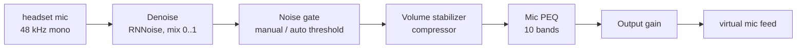

# Mic chain (M6): denoise → gate → compressor → mic EQ

Processes the headset microphone before it reaches the virtual "StealSeries Microphone"
([virtual-mic-driver.md §7](virtual-mic-driver.md)). Covers SON-19 (AI noise cancelling),
SON-21 (noise gate, manual + automatic threshold), SON-23 (volume stabilizer) and SON-25 (mic EQ)
from [feature-inventory.md](../re/feature-inventory.md). Later: SON-22 (impact NR), SON-24 (AEC).

## 1. What we know about the original ([sonar.md §3.2](../re/sonar.md))

| Original (`CMic` graph, capture config JSON) | Status | Our decision |
|---|---|---|
| DNN denoise "ClearCast AI" (`R-Vox_DnzDrvMultiChannel_4.0.0.onnx`, DeepVQE-S style), `noiseCancelingState{value = mix 0..1}`, default 0.9 | Observed | Open model instead of the proprietary one: **RNNoise** via `nnnoiseless` first, DeepFilterNet later. Same parameter: dry/wet **mix 0..1, default 0.9**. |
| `noiseGateState{value = threshold dB}` default −60, `automaticNoiseGateState`, `kSet_NoiseGate{…,AutoThreshold,OffsetDB}` | Observed (names, default) | Existing `ss-dsp::NoiseGate`; automatic mode = noise-floor tracker + offset (§4). Offset default is ours (+10 dB, original Unknown). |
| `volumeStabilizerState` → `kSet_CaptureCompressor{State,Level}` | Observed (names) | Existing `ss-dsp::Compressor` with a voice preset; curve is ours (original Unknown). |
| `parametricEQ` on capture (10 bands, same filter types) | Observed | Existing `ss-dsp::ParametricEq`, same settings model as playback. |
| Block order inside `CMic` | Unknown | Ours, see §2. |

## 2. Signal flow



Order rationale:

1. **Denoise first**: the model is trained on raw noisy speech; every block before it would change
   the noise it has to recognise.
2. **Gate after denoise**: the residual floor is much lower, so the gate threshold separates voice
   from silence reliably and does not chatter on fan noise.
3. **Compressor after the gate**: its makeup gain must not lift the floor in pauses.
4. **EQ last**: tonal shaping of the final voice; boosts are not undone by the compressor.

Every block can be bypassed; a bypassed chain is bit-exact passthrough (after the fixed latency).

## 3. Denoise block (`ss-dsp::Denoiser`)

- `nnnoiseless` 0.5.2, **BSD-3-Clause** (compatible with MIT OR Apache-2.0; notice in
  `THIRD_PARTY` when we ship binaries), `default-features = false` (drops its CLI deps). The model
  weights are compiled into the crate — nothing to download.
- RNNoise works on **480-sample frames at 48 kHz** with samples scaled to the `i16` range
  (±32768). The block converts scale on the way in and out.
- **Frame adaptation**: the IOProc delivers 512-frame blocks. A fixed input FIFO collects samples,
  each full 480-frame is denoised into an output FIFO, and output starts after priming with one
  frame of silence. Result: a **constant extra latency of 480 samples (10 ms)** on top of the
  model's own overlap-add delay, independent of the callback size. Both FIFOs are allocated in
  `new()` for the largest supported callback (4096 frames).
- **Mix**: `out = mix · denoised + (1 − mix) · dry`, where `dry` is delayed by the same total
  latency so both are time-aligned (the alignment is measured in a unit test with an impulse).
- Real-time safety: `DenoiseState` allocates only in `new()`; `process_frame` uses stack arrays
  and pre-planned FFT buffers (**Inferred** from the source; a unit test with a counting global
  allocator asserts zero allocations in `process` after warm-up).
- Total added mic latency target: **≤ 25 ms** (measured end to end in the hardware test).

## 4. Automatic gate threshold

`threshold = noise_floor + offset`, where `noise_floor` is the minimum of the block RMS (dBFS) over
a sliding window of ~2 s with slow upward drift (minimum statistics), evaluated **after** the
denoiser. Clamped to −80…−20 dBFS. Manual mode uses the configured threshold as today.

## 5. API (platform-free, `ss-dsp`)

```rust
pub struct MicChainSettings {
    pub denoise: Option<f32>,              // mix 0..=1, None = off
    pub gate: Option<GateMode>,            // Manual(threshold dB) | Automatic { offset_db }
    pub stabilizer: Option<CompressorSettings>,
    pub eq: ParametricEqSettings,
    pub gain_db: f32,
}
pub struct MicChain { /* Denoiser, NoiseGate, Compressor, ParametricEq, Gain */ }
impl MicChain {
    pub fn new(sample_rate: f32, max_block: usize) -> Result<Self, DspError>; // mono
    pub fn set(&mut self, settings: &MicChainSettings);   // no allocation
    pub fn latency_frames(&self) -> usize;
}
impl Processor for MicChain { /* in place, mono */ }
```

- `MicFeedSession` (macOS) takes a `MicChain` and runs it in the IOProc between the mono mixdown
  and the feed buffer. Live parameter changes come with the daemon (M5) via the usual `rtrb`
  command queue; in M6 settings are fixed at start (`ssmix mic` flags).
- `ssdsp` gets the same flags for offline A/B listening tests on WAV files.
- The same chain will run in the Windows mic path (M4), so presets sound identical.

## 6. Spike: Apple Voice Processing I/O as optional "macOS native" denoise

Questions to answer with measurements before deciding (owner asked for this, see `CLAUDE.md`):

| Question | Result |
|---|---|
| Can `kAudioUnitSubType_VoiceProcessingIO` capture the Nova Pro mic next to (or instead of) our aggregate IOProc, and hand its output to the feed? | ⏳ |
| Does it duck other playback, and does `kAUVoiceIOProperty_OtherAudioDuckingConfiguration` turn that off? | ⏳ |
| Which device does it capture from when the system default input differs? | ⏳ |
| Blind A/B vs. RNNoise (same recording, owner rates) | ⏳ |
| Added latency | ⏳ |

Known limitation: third-party apps cannot set the system microphone mode (Voice Isolation)
programmatically; they can only open the picker. VPIO becomes a selectable denoise engine only if
it wins the A/B and fits the architecture.

## 7. Testing

- Unit tests per block (existing gate/compressor/PEQ tests) plus: denoiser latency and dry/wet
  alignment (impulse), noise attenuation on synthetic white noise (≥ 10 dB at mix 1.0), speech-like
  tone bursts preserved, bypass = delayed passthrough, auto-threshold convergence, zero
  allocations in `process`.
- Listening tests: `ssdsp` on recordings of the Nova Pro mic (typing, fan, voice).
- Hardware checklist: `docs/hardware/macos-mic-chain.md`.
