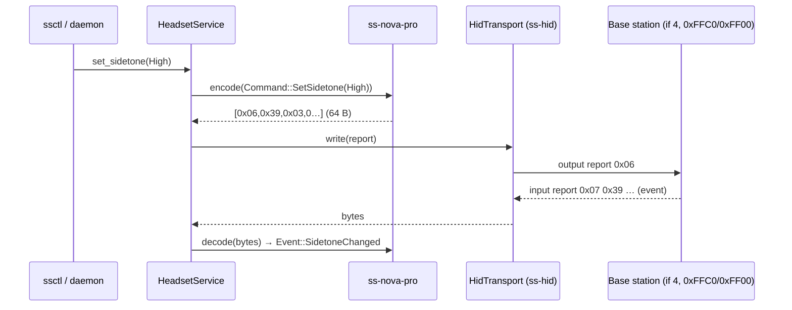
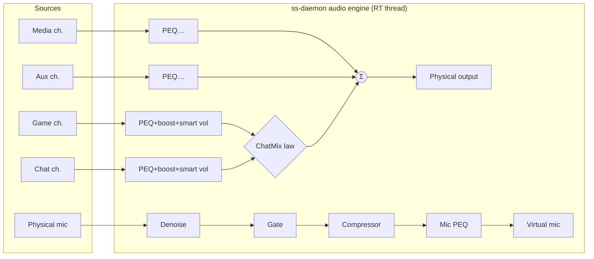

# Architecture overview

Scope: v1 as decided in [ADR 0001](../adr/0001-v1-scope.md) — Arctis Nova Pro Wireless headset
features + Sonar-style AudioMix on **Windows and macOS**.

## 1. Goals and non-goals

| Goals | Non-goals (v1) |
|---|---|
| One codebase, two OSes (Windows 10/11, macOS 14.4+) | Other device families, lighting, Moments |
| Headset control without vendor software | SteelSeries account, cloud, telemetry |
| Virtual channels, per-app routing, ChatMix, EQ, mic chain | Licensed DSP (DTS, A-Volute models) |
| Real-time-safe audio path, < 10 ms added latency | Firmware flashing |
| Small, testable crates with clean boundaries | Drop-in replacement of GG's internal API |

## 2. Lessons from the original (what we do differently)

| Original GG (see `docs/re/`) | StealSeries |
|---|---|
| 5+ processes in 3 languages (.NET, Go, C++, Electron) talking HTTPS on ephemeral ports | One daemon (Rust) + one UI process |
| Local API without auth, leaks account data (gg-core.md) | Local API bound to 127.0.0.1, per-session bearer token, opt-in |
| DSP inside a Windows APO + kernel VAD → Windows-only (sonar.md §5) | DSP in our own user-space engine; only thin virtual endpoints are OS-specific |
| Per-app routing via undocumented WinRT interface with build-dependent IIDs | Same mechanism on Windows but isolated in one adapter with version detection + fallback; Process Taps on macOS |
| Settings pushed through the registry to the APO | Lock-free parameter updates (`rtrb`/atomics) inside one process |
| Tokens/settings in world-writable SQLite | Per-user config dir, secrets none (no account) |

## 3. Layering (hexagonal)

```mermaid
flowchart TB
  subgraph Apps["Binaries (composition roots)"]
    CLI[ssctl CLI]
    D[ss-daemon]
    UI[ss-ui (Tauri 2)]
  end
  subgraph Services["Application services"]
    HS[HeadsetService]
    MX[MixerService]
    PR[PresetService]
  end
  subgraph Domain["Domain (no OS deps)"]
    CORE[ss-core: device + mixer + preset models, port traits]
    NOVA[ss-nova-pro: protocol encode/decode]
    DSP[ss-dsp: filters, dynamics, chain]
  end
  subgraph Adapters["Adapters (cfg(target_os))"]
    HID[ss-hid: hidapi transport]
    AW[ss-audio-windows: WASAPI, policy config]
    AM[ss-audio-macos: CoreAudio, process taps]
    HAL[ss-hal-driver-macos: AudioServerPlugIn]
    ST[ss-store: config files]
  end
  CLI --> HS
  D --> HS & MX & PR
  UI -->|local API| D
  HS --> CORE & NOVA
  MX --> CORE & DSP
  PR --> CORE
  HID -. implements .-> CORE
  AW -. implements .-> CORE
  AM -. implements .-> CORE
  ST -. implements .-> CORE
  AM <-->|shared-memory ring| HAL
```

Dependency rule: arrows point inward. `ss-core` depends on nothing OS-specific; adapters implement
traits ("ports") defined in `ss-core`; binaries wire concrete adapters into services.

## 4. Crates

| Crate | Kind | Responsibility | Status |
|---|---|---|---|
| `ss-core` | lib | Value objects (EQ gain, volume, battery, noise control…), mixer & preset models, port traits (`HidTransport`, …) | v1 – in progress |
| `ss-nova-pro` | lib | Pure encoder/decoder for the Nova Pro Wireless HID protocol (no I/O) | v1 – done |
| `ss-hid` | lib | `hidapi`-based transport: discovery, open both vendor collections, read/write | v1 – done |
| `ssctl` | bin | CLI for headset status and settings (first usable deliverable, hardware testing) | v1 – done |
| `ss-dsp` | lib | Biquad PEQ, gain, compressor, gate, smart volume, ChatMix law, denoise wrapper; RT-safe | v1 – done (denoise in M6) |
| `ssdsp` | bin | Offline WAV processing for listening tests | v1 – done |
| `ss-audio-windows` | lib | Device enumeration, WASAPI streams, process-loopback capture, `IAudioPolicyConfig` routing | v1 – planned |
| `ss-audio-macos` | lib | CoreAudio devices, AUHAL I/O, Audio Process Taps, driver IPC | v1 – planned |
| `ss-hal-driver-macos` | cdylib | Minimal AudioServerPlugIn exposing virtual channels; ring buffer to the daemon | v1 – planned |
| `ss-store` | lib | Versioned JSON config/preset files in the per-user config dir | v1 – planned |
| `ss-daemon` | bin | Long-running service: devices, audio engine, local API, hotkeys, tray | v1 – planned |
| `ss-ui` | bin | Tauri 2 UI talking to the daemon | v1 – planned |

## 5. Headset control path



- Protocol facts come from [prior-art §1](../research/prior-art.md) and are **Inferred** until verified
  on hardware (the GG `.edevice` specs are encrypted and will not be decrypted, see engine.md §4.2).
  Each constant in `ss-nova-pro` links to its table row.
- Dangerous commands (factory reset `0xFD`, firmware) are **not representable** in the `Command` enum.
- Writes are serialised through a single I/O owner per device (engine.md §10 lesson).

## 6. Audio engine (Sonar core)



Where the channels come from:

| | Windows (phase 1) | macOS |
|---|---|---|
| Virtual endpoints apps can pick | Phase 1: none of our own — use per-app **process-loopback capture** + mute original via routing to a silent/secondary endpoint; phase 2: SysVAD-derived driver | `ss-hal-driver-macos` AudioServerPlugIn (Game/Chat/Media/Aux outputs, virtual mic input) |
| Per-app routing | `IAudioPolicyConfig::SetPersistedDefaultAudioEndpoint` (sonar.md §2.3) | Audio Process Taps (14.4+) or user selects our device in the app |
| Physical output/input | WASAPI (`wasapi` crate) | AUHAL (`objc2-core-audio`) |

The exact Windows phase-1 strategy is an open decision → will become ADR 0003 after a spike.

**Real-time rules** (see AGENTS.md): audio callbacks never allocate, lock, log or block. Control
changes travel as small messages over an `rtrb` SPSC queue; meters travel back the same way.

## 7. Configuration and API

- Config: versioned JSON files in the OS config dir (`%APPDATA%\StealSeries`, `~/Library/Application Support/StealSeries`).
- Presets: import/export as JSON; a converter for Sonar's config JSON shape (sonar.md §4) is a later nicety.
- Local API (daemon ↔ UI): HTTP/WS on 127.0.0.1, random port, bearer token written to a user-only file.
  A Sonar-compatible subset (`/v1/chatMix`, `/volumeSettings`) may be offered opt-in later.

## 8. Error handling, logging, testing

- Libraries: `thiserror` enums per crate; binaries: `anyhow`.
- Logging: `tracing` (never on the RT thread).
- Tests: protocol encoders/decoders are table-tested against the documented bytes; DSP against
  reference curves; hardware tests are `#[ignore]` and run manually.

## 9. Roadmap

1. ✅ **M1 – Headset CLI:** `ss-core`, `ss-nova-pro`, `ss-hid`, `ssctl` (status, battery, ANC, sidetone, mic, EQ, ChatMix events). Hardware verification on the owner's Nova Pro Wireless.
2. ✅ **M2 – DSP:** `ss-dsp` with tests; offline WAV processing tool for listening tests.
3. **M3 – macOS audio:** HAL driver + `ss-audio-macos`, end-to-end Game/Chat routing with ChatMix dial.
4. **M4 – Windows audio:** spike + ADR 0003, `ss-audio-windows`.
5. **M5 – Daemon + UI:** local API, tray, hotkeys, presets, onboarding.
6. **M6 – Mic chain:** denoise (nnnoiseless → DeepFilterNet), gate, compressor, mic EQ.
