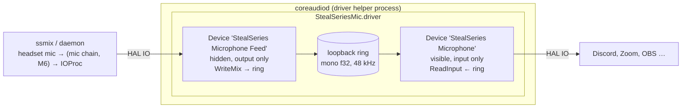

# Virtual microphone on macOS (M3b): `ss-hal-driver-macos`

Decision context: [ADR 0002](../adr/0002-macos-audio-strategy.md) ("minimal AudioServerPlugIn,
loopback inside the driver, no DSP, no IPC"). Prior art: [prior-art §2](../research/prior-art.md)
(no mature Rust AudioServerPlugIn crate exists; BlackHole/BackgroundMusic are GPL → not read for
code). Interface reference: Apple's public SDK header `CoreAudio/AudioServerPlugIn.h` and
`AudioHardwareBase.h`.

## 1. What the user sees

- One new **input** device, **"StealSeries Microphone"**, selectable in Discord, Zoom, OBS,
  QuickTime and as system input.
- Nothing else. The device the daemon writes into is **hidden**.

## 2. Object model

The plug-in publishes two devices that share one ring buffer and one clock:

| Object ID | Object | Notes |
|---|---|---|
| 1 | Plug-in (`kAudioObjectPlugInObject`) | owns both devices |
| 2 | Device **StealSeries Microphone**, UID `dev.stealseries.mic` | input only, can be default input, not default system device |
| 3 | its input stream | 1 channel, terminal type microphone |
| 4 | Device **StealSeries Microphone Feed**, UID `dev.stealseries.mic.feed` | output only, `IsHidden = 1`, cannot be default |
| 5 | its output stream | 1 channel |

Why two devices instead of one BlackHole-style loopback device: a single device would also appear
as an *output* called "StealSeries Microphone" in every app and in Sound settings, inviting users
to send audio into their own mic. A hidden output device keeps the UI clean; the daemon opens it
by UID. The HAL runs client IO on the hidden device normally (**Observed**,
[macos-virtual-mic.md](../hardware/macos-virtual-mic.md) check 6).

No volume/mute controls in v1: gain and mute live in the daemon (M6 mic chain). Apps use their
own input level.

## 3. Format and clock

- Fixed **48 kHz, 32-bit float, 1 channel, packed** (`lpcm`, flags float|packed). The headset mic
  is mono at 48 kHz (check 2 of the M3a log), so no conversion is needed. Apps that want stereo get
  it from the HAL's format conversion.
- One clock for both devices, derived from `mach_absolute_time`:
  `sample_time = n · P`, `host_time = anchor + n · P · ticks_per_frame` with period
  `P = 16384` frames (`ZeroTimeStampPeriod`) and `n = ⌊(now − anchor) / (P · ticks_per_frame)⌋`.
  The anchor is set when the first IO of either device starts. This is stateless apart from the
  anchor, so `GetZeroTimeStamp` needs no lock.
- Both devices report the same `ClockDomain`, so a sample time on the feed side is the same instant
  on the mic side.
- The daemon's aggregate (headset input + feed output) does drift compensation between the
  headset clock and ours, exactly like the M3a tap aggregate.

## 4. Loopback ring (real-time safe)

- Capacity = `P` frames. Storage is `AtomicU32` (f32 bits) with relaxed ordering: no `unsafe`, no
  locks, no allocation after creation. Torn reads across a wrap are impossible because each sample
  is a single atomic word.
- **WriteMix** (feed device) writes the cycle's frames at `mOutputTime.mSampleTime` and advances
  `written_until` (atomic, monotonic max).
- **ReadInput** (mic device) reads at `mInputTime.mSampleTime`. Frames at or beyond
  `written_until`, or older than `written_until − capacity`, read as **silence**. So when the
  daemon stops, the mic goes silent instead of replaying the last 340 ms forever.
- The output time of a cycle is ahead of the input time, so data written for instant T is in the
  ring before any reader asks for T. Added latency ≈ one IO buffer on each side.

## 5. Crate layout (`crates/ss-hal-driver-macos`)

| Module | OS | Responsibility |
|---|---|---|
| `ring` | any | `LoopbackRing` (§4), unit-tested |
| `clock` | any | zero-timestamp math (§3), unit-tested |
| `model` | any | object IDs, the property table as plain Rust values (`PropertyValue`), UID lookup, unit-tested |
| `selectors` | any | four-char codes from `AudioHardwareBase.h` / `AudioServerPlugIn.h`, named; a macOS test cross-checks them against `objc2-core-audio` |
| `ffi` (macOS) | macOS | `#[repr(C)]` vtable, factory `StealSeriesMic_Create`, COM refcounting, value serialisation (CFString, ASBD, ranges), IO entry points. Every entry point is wrapped in `catch_unwind` and maps errors to HAL status codes. |

`crate-type = ["cdylib", "rlib"]`: the cdylib is the driver binary, the rlib lets the portable
logic be tested on every OS.

## 6. Build, install, remove

`scripts/macos/hal-driver.sh build|install|uninstall`:

1. `cargo build --release -p ss-hal-driver-macos`
2. Assemble `target/StealSeriesMic.driver/Contents/{Info.plist, MacOS/StealSeriesMic}`.
   `Info.plist` registers factory UUID → `StealSeriesMic_Create` for type
   `443ABAB8-E7B3-491A-B985-BEB9187030DB` (`kAudioServerPlugInTypeUUID`).
3. Ad-hoc `codesign --sign -` (enough for local development; distribution needs Developer ID +
   notarisation, ADR 0002).
4. `install`: `sudo cp -R` into `/Library/Audio/Plug-Ins/HAL/` and `sudo killall coreaudiod`
   (all audio drops for ~1 s while it restarts). `uninstall` removes it the same way.

## 7. Daemon side (`ss-audio-macos::MicFeedSession`, `ssmix mic`)

- Finds the feed device via `kAudioHardwarePropertyTranslateUIDToDevice`.
- Creates a private aggregate device: headset (main, clock) + feed (drift compensated).
- Uses `kAudioDevicePropertyIOProcStreamUsage` to switch off the headset's *output* stream for its
  IOProc, so the mic path never touches playback.
- IOProc: headset mic buffer → gain → feed buffer. M6 later inserts the mic chain (denoise, gate,
  compressor, EQ) at this point.
- Stream order in this aggregate follows the sub-device list (**Observed**, check 5); `--probe`
  reports it.

## 8. Out of scope for M3b

Mic DSP (M6), Developer-ID signing/notarisation and an installer (M5), sample-rate switching,
volume/mute controls on the virtual device, more than one virtual device (Stream mix, later).
