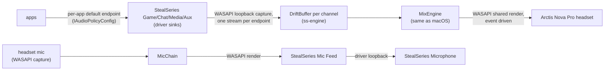

# Windows virtual audio driver and full AudioMix (M4b)

Decision context: [ADR 0004](../adr/0004-windows-audio-strategy.md) — process loopback cannot
capture an app while its playback is silenced (S3/S4, **Observed**), so per-channel DSP and the
virtual microphone need virtual endpoints. M4a (session mixer) stays as the fallback when the
driver is not installed.

Status: **design + user-mode preparation** (2026-11-14). Driver code waits for the owner's OK to
install the WDK and to enable test-signing mode.

## 1. Endpoints (one driver package `StealSeriesAudio`)

| Endpoint (friendly name) | Flow | In the driver | Used by |
|---|---|---|---|
| StealSeries Game | render | sink: accepts and discards data, reports position | apps routed to Game |
| StealSeries Chat | render | sink | Discord, Teams … |
| StealSeries Media | render | sink; becomes the **Windows default output** while AudioMix runs, so unassigned apps land here (SON-06) | everything else |
| StealSeries Aux | render | sink | optional |
| StealSeries Mic Feed | render | writes into the driver-internal loopback buffer | our process only (hidden from users as far as Windows allows — Unknown) |
| StealSeries Microphone | capture | reads the loopback buffer | Discord, Zoom, OBS … |

Format: 48 kHz, stereo for render endpoints, mono for the microphone, 32-bit float and 16-bit PCM
offered (the shared-mode engine converts). The driver holds **no DSP and no IPC**, like the macOS
HAL driver ([virtual-mic-driver.md](virtual-mic-driver.md)): only sinks and one loopback pair.

Base: Microsoft **SysVAD** sample (`audio/sysvad`, MS-PL, WaveRT + PortCls, KMDF), reduced to the
endpoints above. Lives in `drivers/windows/` as a separate C++ component; MS-PL files keep their
licence headers (compatible with shipping beside MIT/Apache code, `prior-art.md` §3). Not a Rust
workspace member.

## 2. User-mode data path (`ss-audio-windows`, M4b backend)

1. **Routing.** Assigned apps get their per-process default render endpoint set to the channel's
   endpoint with the undocumented `IAudioPolicyConfig::SetPersistedDefaultAudioEndpoint`
   (two IIDs by Windows build, **Observed** in Sonar, `sonar.md` §2.3; EarTrumpet uses the same).
   The device id is passed as `\\?\SWD#MMDEVAPI#<endpoint id>#{e6327cad-dcec-4949-ae8a-991e976a79d2}`.
   Unassigned apps follow the Windows default output, which AudioMix switches to "StealSeries
   Media" and restores on stop (like the default-input handling on macOS). Apps that ignore
   per-app defaults (Sonar keeps a "routing-error-prone" list) stay on Media.
2. **Capture.** A standard WASAPI **loopback** stream on each virtual render endpoint returns what
   the audio engine mixed for it (**Inferred** to work for a sink driver: loopback is taken in the
   engine before the data reaches the driver).
3. **Mixing.** `MixEngine` from `ss-engine` — identical DSP, ChatMix and fader law to macOS — runs
   in the render callback of the headset stream.
4. **Clocks.** Each endpoint is paced by its own driver clock: the virtual ones by a timer, the
   headset by its USB clock. Unlike the macOS aggregate device nothing aligns them, so every
   captured channel passes through a **`DriftBuffer`** (`ss-engine`, implemented and tested now):
   an SPSC ring buffer whose reader resamples by a few hundred ppm to hold its fill level at a
   target (PI control, cubic interpolation). Target fill ≈ 2 headset periods (≈ 20 ms) — the
   latency budget is Unknown until measured.
5. **Virtual mic.** Headset mic → `MicChain` (live changes as on macOS) → render to "StealSeries
   Mic Feed" → driver loopback → "StealSeries Microphone". The same `DriftBuffer` sits between the
   mic capture and the feed render.

## 3. Development and signing

| Step | Needs | Status |
|---|---|---|
| Build | Visual Studio Build Tools 2022 (**present**), Windows SDK 10.0.26100 (**present**), **WDK** matching the SDK (missing; contains `portcls.h`, `inf2cat`) | owner OK to install |
| Load on the owner's PC | `bcdedit /set testsigning on` (admin, reboot; usually requires Secure Boot off), test certificate, `pnputil /add-driver … /install` | owner OK |
| Distribution | EV code-signing certificate + Microsoft attestation signing (Partner Center) | later, before any release |

A driver bug can crash Windows (blue screen). Development therefore starts with the sinks only,
adds the loopback pair afterwards, and every install step is reversible (`pnputil /delete-driver`,
`bcdedit /set testsigning off`).

## 4. What is prepared now (no driver needed)

- `ss_engine::DriftBuffer` with unit tests (steady state, faster/slower producer, underrun,
  no allocation on the audio path).
- `ss-audio-windows::policy` — bindings for `IAudioPolicyConfig` (get/set per-app default
  endpoint) with the vtable layout read from Sonar's interop metadata (`sonar.md` §2.3). Verified
  read-only on the owner's PC: the 21H2+ interface activates and `Get…` works (`winspike
  policy`). `Set…` is not yet exercised — a reversible round trip (set an app to the endpoint it
  already uses, read back, clear) needs the owner's OK because it writes a persisted setting.

## 5. Open questions

- Can "StealSeries Mic Feed" be hidden from the Sound settings? (Unknown; SysVAD has no flag
  that removes an endpoint from the UI.)
- Latency of the whole loopback → engine → headset path (target < 30 ms; Unknown).
- Behaviour of apps in exclusive mode (bypass the virtual endpoints; documented limitation).
